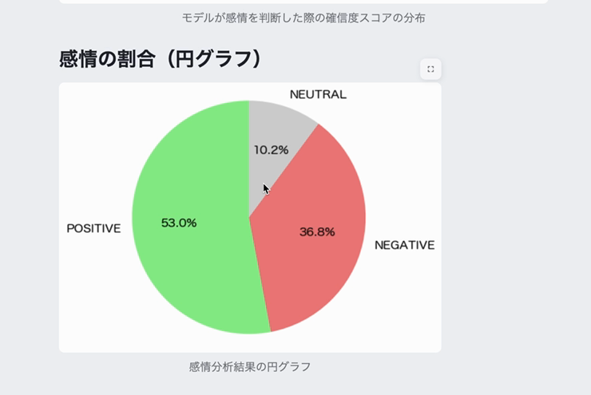
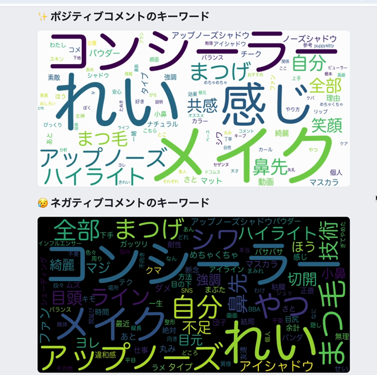
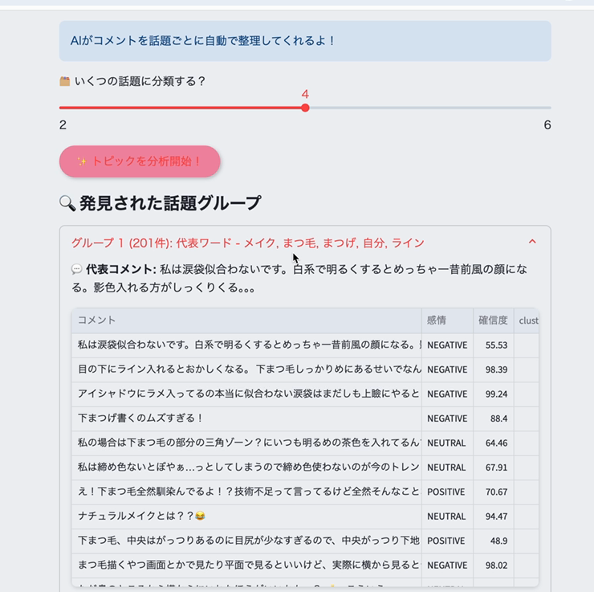

# 💄 流行りのメイクを深掘り！コメント分析ツール

YouTubeのコメントを収集・分析し、特定のメイクや美容トレンドに対するユーザーの生の感想・評価を可視化するソーシャルリスニングツールです。

## 概要

ユーザーが入力したキーワードに関連するYouTube動画を検索し、コメントを自動収集。日本語BERTモデルによる感情分析、クラスタリング、LLMによる洞察生成を通じて、コメントの背後にあるニーズや不満を可視化します。

## 主要機能

- **キーワード検索・コメント自動取得**：YouTube動画をキーワード検索し、選択した動画のコメントを取得
- **感情分析**：日本語BERTモデルでコメントをポジティブ/ネガティブ/ニュートラルに分類
- **多角的な可視化**：感情割合グラフ、確信度フィルター、頻出単語ランキング、ワードクラウド
- **コメントの自動クラスタリング**：Sentence Transformers + KMeansで話題ごとにグループ化
- **LLMによる詳細分析**：Gemini APIでネガティブコメントから改善提案、ポジティブコメントから強みを生成
- **代表コメントの抽出・CSVダウンロード**

## スクリーンショット

*2025年6月のデモ画面より*

| 感情分析（円グラフ） | ワードクラウド |
|---|---|
|  |  |


*コメントの自動クラスタリング（2025年6月のデモ画面）*

その他のスクリーンショット（Geminiによる詳細分析など）は `docs/images/` にあります。

## 実装上の工夫

1. **ファンコメントなどのノイズ除去**
   コメント内の名詞をJanomeで形態素解析し、「可愛い」「最高」など配信者への賛辞コメントで頻出する単語リストとの一致率が50%を超える場合、そのコメントを分析対象から除外しています。動画の主題と無関係なノイズを減らすための前処理です。

2. **日本語BERTの入力長制限への対応と前処理**
   絵文字・顔文字・ネットスラング（「wwww」「草」等）を意味の近い日本語表現に変換する前処理を行った上で、transformersの`truncation`機能により512トークンを超える長文コメントを自動的に切り詰め、モデルの入力長エラーを回避しています。

3. **確信度フィルタリングによる分析対象の調整**
   モデルが感情を判定した際の確信度スコアをスライダーで指定し、閾値未満のコメントをグラフ・代表コメント抽出・LLM分析・CSV出力の対象から一括で除外できる仕組みを実装しています。

4. **Sentence Transformers（E5）＋KMeansによる話題分類**
   `intfloat/multilingual-e5-large`でコメントをベクトル化し、KMeansでクラスタリングしています。各クラスタの代表ワードはJanomeで抽出した名詞の頻度から算出し、コメント数が20件未満の場合はクラスタリングを実行しない制限を設けています。

5. **Gemini APIのプロンプト設計による洞察生成**
   LLMに「美容トレンドを分析する専門家」という役割を与えた上で、感情ラベルごとに「不満点・改善提案」（ネガティブ）、「評価点・強み」（ポジティブ）といった出力項目をプロンプトで指定し、コメント群から構造化された洞察を生成する設計にしています。

## 使用技術

- **フロントエンド/UI**: Streamlit
- **感情分析**: Transformers（`koheiduck/bert-japanese-finetuned-sentiment`）
- **クラスタリング**: Sentence Transformers（`intfloat/multilingual-e5-large`）, scikit-learn（KMeans）
- **LLM連携**: Google Gemini API（`gemini-3.8-flash`）
- **データ収集**: yt-dlp, youtube-search-python
- **前処理/可視化**: Janome, pandas, matplotlib, WordCloud

## ローカルでの起動方法

```bash
# 1. 仮想環境の作成・有効化
python -m venv venv
source venv/bin/activate  # macOS/Linux

# 2. 依存パッケージのインストール
pip install -r requirements.txt

# 3. .env ファイルを作成し、Gemini APIキーを設定
echo "GEMINI_API_KEY=<発行したAPIキー>" > .env
# ※ 感情分析・クラスタリングのモデルは公開モデルのため、Hugging Faceトークンは不要です

# 4. アプリの起動
streamlit run app.py
```

## 更新履歴

2025年に開発したアプリをベースに、2026年にライブラリ更新・不具合修正・動作検証を実施しました。
